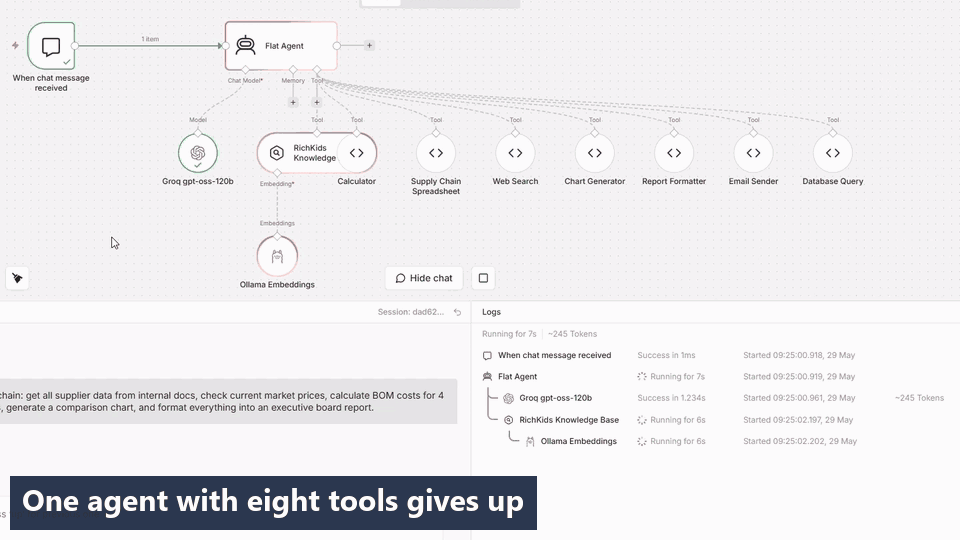

[English](README.md) · **Français**

# GenAI4SC : agents d'IA pour la supply chain

**Des professionnels de la supply chain construisent des agents d'IA en direct, sans écrire de code.** Mes trois sessions sur les agents dans GenAI4SC, un cours international en 9 sessions : je les ai préparées et données, deux en binôme.

*Démo de l'instructeur dans n8n, vraie exécution, accélérée. [Vidéo complète (1 min 31)](https://drive.google.com/file/d/1bJ8uv2e7hfYDbE_1NuIyIZVNIgUMSoKV/view)*

## Ce qu'on y fait

- **Bases des agents.** Quatre exercices dans n8n, d'un premier agent conversationnel à un agent qui consulte une base documentaire (RAG) et cherche sur le web.
- **Orchestration.** Sur une entreprise fictive, un agent principal confie le travail à six sous-agents spécialisés (analyse, recherche web, base documentaire, graphiques, rédaction du rapport, contrôle qualité), regroupés en équipes.
- **Conception d'application.** Chaque groupe ouvre un terminal dans son navigateur avec un seul mot de passe et va, avec Claude Code, d'une idée à une carte d'architecture, une maquette interactive, des histoires utilisateur et une présentation finale.
- **Quiz à étapes.** L'étape suivante se débloque avec un code projeté par l'instructeur ; un classement s'affiche en direct.

## Architecture

Diagramme en français

## Réalisé

- **Cours.** Donné en entier au printemps 2026 : 9 sessions de 2 heures.
- **Matériel.** 19 workflows n8n avec un serveur de secours en miroir, quatre terminaux de groupe, un support de 21 diapositives, des tutoriels et des vidéos d'exercices.
- **Retours.** Sondage de l'ensemble du cours, 11 répondants : 9 recommanderaient le cours, 2 sont neutres ; tous jugent excellentes les qualités de présentation des instructeurs (55 % tout à fait d'accord).
- **Aujourd'hui.** Le serveur n8n principal et les terminaux de groupe sont arrêtés ; le serveur n8n de secours de l'école tourne toujours. Le matériel et le travail des participants restent privés.
- **Pile.** n8n, Groq, Tavily, Ollama (embeddings), `ttyd`, `tmux`, Docker, Traefik, Node.js, Claude Code, Google Apps Script, Slidev.

---

**Anthony Hunt** · [ingevision.cloud](https://ingevision.cloud/?p=genai4sc) · [LinkedIn](https://www.linkedin.com/in/anthony-hunt-3948a9196) · [GitHub](https://github.com/anthohunt)
