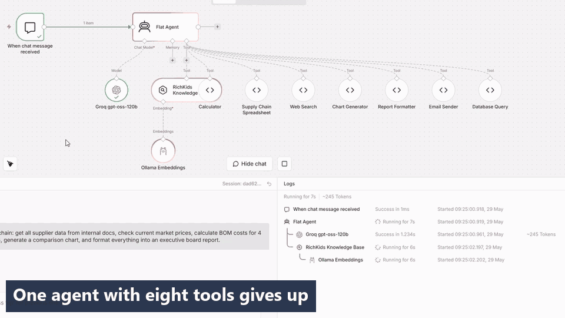
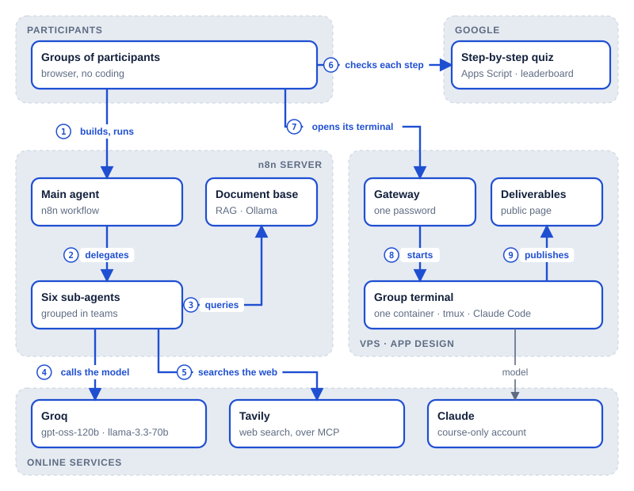

**English** · [Français](README.fr.md)

# GenAI4SC: AI agents for supply chain

**Supply chain professionals build AI agents live, without writing code.** My three agent sessions in GenAI4SC, an international 9-session course: I prepared and taught all three, two with a co-instructor.

*Instructor demo in n8n, real run, sped up. [Full video (1:31)](https://drive.google.com/file/d/1bJ8uv2e7hfYDbE_1NuIyIZVNIgUMSoKV/view)*

## Using it

- **Agent foundations.** Four n8n exercises, from a first chat agent to one that reads a document base (RAG) and searches the web.
- **Orchestration.** On a fictional company, a main agent hands the work to six specialised sub-agents (analysis, web research, document base, charts, report writing, quality control), grouped into teams.
- **Application design.** Each group opens a terminal in its browser with one password and goes, with Claude Code, from an idea to an architecture map, an interactive mockup, user stories and a final presentation.
- **Step-by-step quiz.** The next step unlocks with a code the instructor projects; a leaderboard updates live.

## Architecture

## Delivered

- **Course.** Given in full in spring 2026: 9 two-hour sessions.
- **Material.** 19 n8n workflows with a mirrored backup server, four group terminals, a 21-slide deck, tutorials and exercise videos.
- **Feedback.** Whole-course survey, 11 respondents: 9 would recommend the course, 2 are neutral; all agree the instructors' presentation skills were excellent (55% strongly).
- **Now.** The main n8n server and the group terminals are stopped; the school's backup n8n server still runs. Material and participants' work stay private.
- **Stack.** n8n, Groq, Tavily, Ollama (embeddings), `ttyd`, `tmux`, Docker, Traefik, Node.js, Claude Code, Google Apps Script, Slidev.

---

**Anthony Hunt** · [ingevision.cloud](https://ingevision.cloud/?lang=en&p=genai4sc) · [LinkedIn](https://www.linkedin.com/in/anthony-hunt-3948a9196) · [GitHub](https://github.com/anthohunt)
